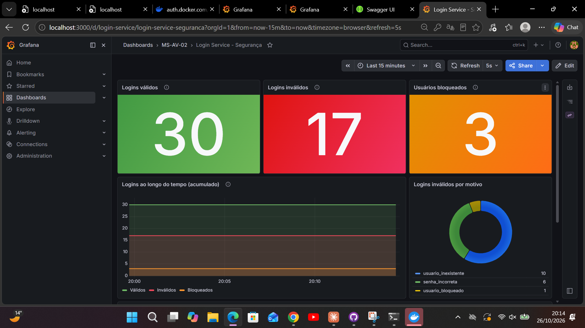
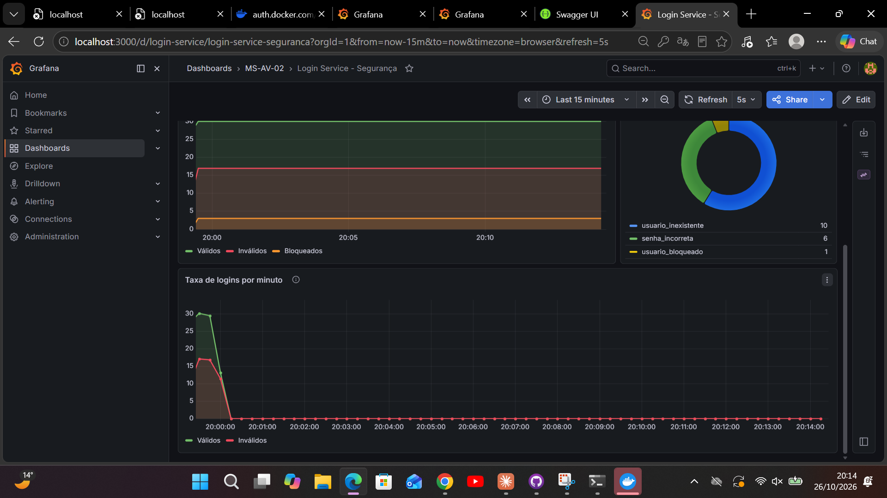

# Login Service: MS-AV-02 (Segurança e Observabilidade)

Atividade **MS-AV-02** da disciplina *Microservices Development* (ESPM).

É um mecanismo de login RESTful feito com **Spring Boot 3.5**, **Spring Security** (`JdbcUserDetailsManager` com roles), **Actuator + Micrometer/Prometheus**, um **dashboard no Grafana** e documentação **OpenAPI / Swagger UI**.

## Endpoints

| Método | Rota | Acesso | Descrição | Respostas |
|---|---|---|---|---|
| POST | `/login` | público | Corpo `{"username":"","senha":""}`. Valida o usuário na tabela `usuarios` | 200 válido, 401 inválido ou bloqueado |
| PUT | `/trocarsenha/{userid}` | público | Corpo `{"atual":"","nova":""}`. Confere a senha atual com a base de dados | 200, 400, 401, 404, 423 |
| POST | `/` | **ROLE_MANUTENCAO** | Cadastra um usuário. Corpo `{"username":"","senha":""}` | 201, 400, 401, 403, 409 |
| GET | `/` | **ROLE_MANUTENCAO** | Lista todos os usuários em JSON, **sem a senha**, com o status de bloqueio | 200, 401, 403 |
| PUT | `/unlock/{userid}` | **ROLE_ADMIN** | Desbloqueia o usuário e zera as tentativas | 200, 401, 403, 404 |

`{userid}` é o `username` do usuário.

### Regra de bloqueio

Cada senha errada incrementa `login_attempts.failed_attempts`. Na **segunda falha** (`failed_attempts > 1`), o usuário recebe `locked = TRUE` e `locked_at` é preenchido. A partir daí, o `/login` responde 401 com `"Usuario bloqueado"`, mesmo que a senha esteja correta, até que um admin chame `/unlock/{userid}`. Um login com sucesso zera as falhas.

O limite fica em `app.seguranca.max-falhas=1` (número de falhas toleradas).

Uma senha atual errada em `/trocarsenha` também conta como falha. Assim o endpoint público não serve para força bruta.

## Segurança

* Os endpoints protegidos usam **HTTP Basic**. Os usuários operacionais e as roles ficam nas tabelas padrão do Spring Security (`users` / `authorities`) e são gerenciados pelo **`JdbcUserDetailsManager`**. As senhas são gravadas com **BCrypt** (`{bcrypt}`, via `DelegatingPasswordEncoder`).
* Usuários criados na inicialização (classe `UsuariosIniciais`):

| Usuário | Senha | Role |
|---|---|---|
| `admin` | `admin123` | ROLE_ADMIN |
| `manutencao` | `manut123` | ROLE_MANUTENCAO |

* Usuários de exemplo do "sistema genérico" (tabela `usuarios`): `maria/maria123`, `joao/joao123`, `ana/ana123`.
* A API é stateless (sem sessão) e o CSRF está desabilitado. Erros de autenticação e autorização voltam em JSON (401 e 403).
* `/swagger-ui.html`, `/v3/api-docs`, `/actuator/health`, `/actuator/info` e `/actuator/prometheus` são públicos. Os demais `/actuator/**` exigem ROLE_ADMIN.

> A tabela `usuarios` do enunciado tem `senha VARCHAR(10)`, que não comporta um hash (um BCrypt tem 60 caracteres). Por isso essas senhas ficam em texto puro, como pede a atividade, e a comparação é feita em tempo constante (`MessageDigest.isEqual`). Num sistema real, a coluna seria maior e a senha seria guardada com hash.

## Banco de dados

H2 em memória. Os scripts são executados automaticamente na inicialização:

* `src/main/resources/schema.sql`: tabelas `users`/`authorities` (JdbcUserDetailsManager) e as tabelas do enunciado, `login_attempts` e `usuarios`. A vírgula sobrando depois de `updated_at` no script original foi removida, porque gerava erro de sintaxe.
* `src/main/resources/data.sql`: usuários de exemplo.

## Métricas (Actuator / Prometheus)

| Métrica (Prometheus) | Tipo | Significado |
|---|---|---|
| `login_validos_total` | counter | quantidade de logins válidos |
| `login_invalidos_total{motivo}` | counter | quantidade de logins inválidos (`senha_incorreta`, `usuario_inexistente`, `usuario_bloqueado`) |
| `usuarios_bloqueados` | gauge | total de usuários bloqueados agora (`SELECT COUNT(*) FROM login_attempts WHERE locked`) |
| `usuarios_bloqueios_total` | counter | eventos de bloqueio |
| `usuarios_cadastrados` | gauge | total de usuários cadastrados |

O código está em `metrics/LoginMetricas.java`. As métricas ficam em `http://localhost:8080/actuator/prometheus` e `http://localhost:8080/actuator/metrics` (este último exige admin).

## Como executar

### Opção 1: Docker Compose (app + Prometheus + Grafana)

```bash
docker compose up --build
```

| Serviço | URL |
|---|---|
| API | http://localhost:8080 |
| Swagger UI | http://localhost:8080/swagger-ui.html |
| OpenAPI (JSON) | http://localhost:8080/v3/api-docs |
| Prometheus | http://localhost:9090 |
| Grafana | http://localhost:3000 (admin / admin) |

O datasource Prometheus e o dashboard **"Login Service - Segurança"** (pasta *MS-AV-02*) são carregados automaticamente via *provisioning*.

### Opção 2: sem Docker

```bash
mvnw.cmd spring-boot:run      # Windows (Maven Wrapper: nao precisa ter o Maven instalado)
./mvnw spring-boot:run        # Linux/Mac
# Prometheus: prometheus --config.file=observabilidade/prometheus/prometheus-local.yml
# Grafana: grafana server -> criar a conexão Prometheus (http://localhost:9090) e
#          importar observabilidade/grafana/dashboards/login-service-dashboard.json
```

Se o Prometheus estiver numa porta diferente de 9090, ajuste a URL do datasource no Grafana.

### Gerar dados para o dashboard

```powershell
powershell -ExecutionPolicy Bypass -File scripts\gerar-trafego.ps1   # Windows
./scripts/gerar-trafego.sh                                           # Linux/Mac
```

O arquivo `requests.http` traz exemplos de todas as chamadas, que podem ser executadas no VS Code (extensão REST Client) ou no IntelliJ.

### Testes

```bash
mvnw.cmd test    # Windows
./mvnw test      # Linux/Mac
```

São testes de integração (MockMvc) cobrindo login 200/401, bloqueio na 2ª falha, unlock somente por admin, troca de senha, cadastro e listagem somente por ROLE_MANUTENCAO, e exposição das métricas e do OpenAPI.

## Dashboard Grafana

Painéis: **Logins válidos**, **Logins inválidos**, **Usuários bloqueados** (stats), evolução dos três indicadores ao longo do tempo, inválidos por motivo (donut) e taxa de logins por minuto.

* Modelo provisionado: `observabilidade/grafana/dashboards/login-service-dashboard.json`
* Export do dashboard (*Export > Export as code / JSON*): `docs/grafana-dashboard-export.json`
* Print screen:





## Estrutura

```
src/main/java/br/com/seguranca/login
├── config       SecurityConfig, OpenApiConfig, UsuariosIniciais
├── controller   UsuarioController (endpoints + anotações OpenAPI)
├── dto          records de request/response
├── exception    ApiException + GlobalExceptionHandler
├── metrics      LoginMetricas (counters e gauges Micrometer)
├── repository   UsuarioRepository (JdbcTemplate: usuarios / login_attempts)
└── service      LoginService (regras de login, bloqueio, troca de senha)
observabilidade/  prometheus.yml + provisioning e dashboard do Grafana
docs/             print e export do dashboard
```
